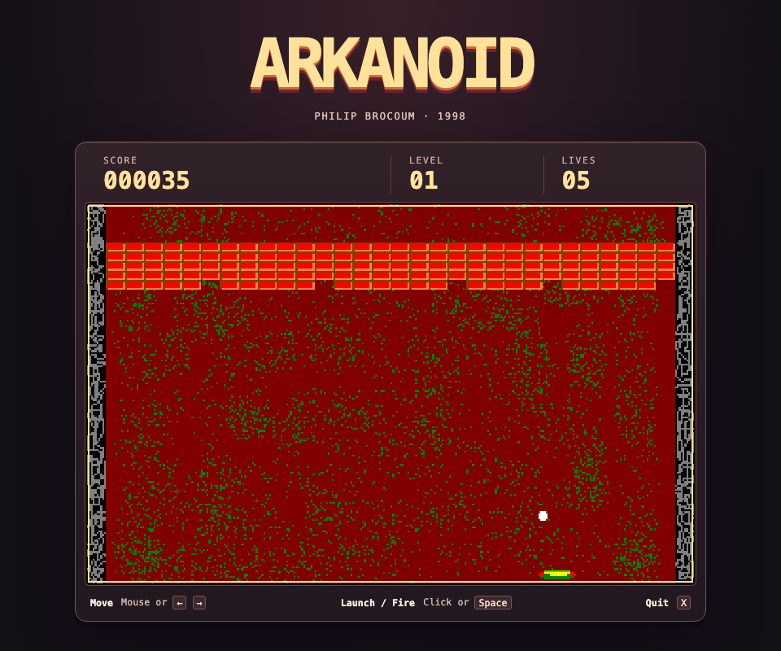

# Arkanoid

Arkanoid is my take on the classic Nintendo Breakout game.

## Play in a browser

**[Play now on GitHub Pages →](https://stedwick.github.io/arkanoid/)**

Move with the mouse or arrow keys. Click or press Space to start, launch, or fire. Press X to return to the demo.

## Local development

Install Bun and Portless, then run `bun install` and `bun run dev`. Open the HTTPS address that Portless prints.

Run `bun test` to check the game rules and `bun run build` to build the static game in `dist/`.

## Original DOS version

See [the original DOS release](C_legacy/README.md) for the C source, game files, and Boxer instructions.
